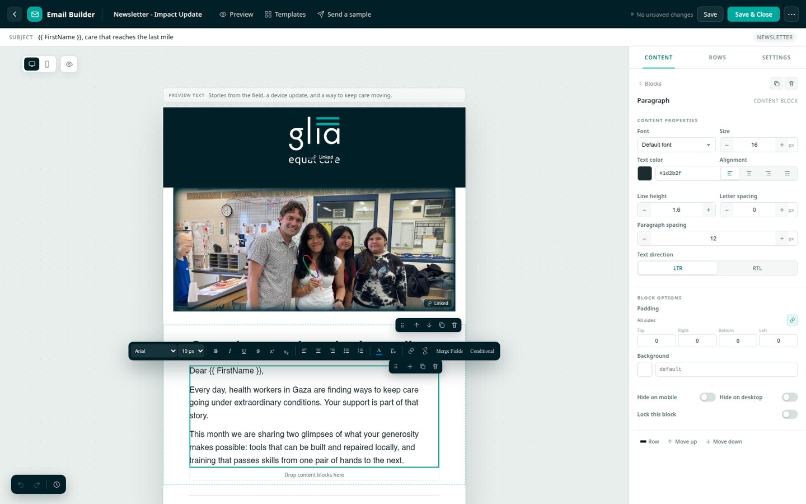
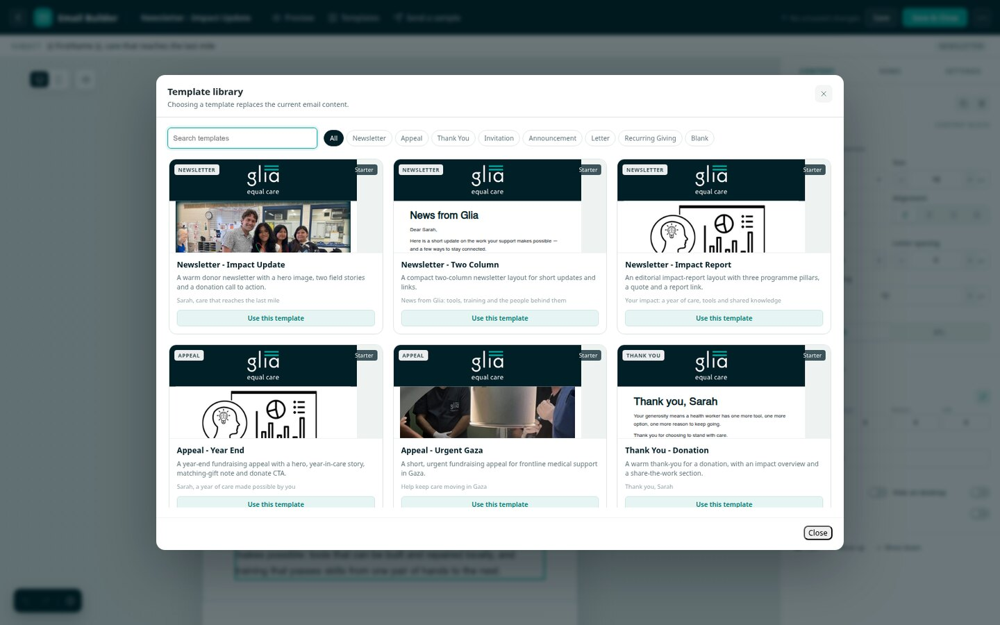
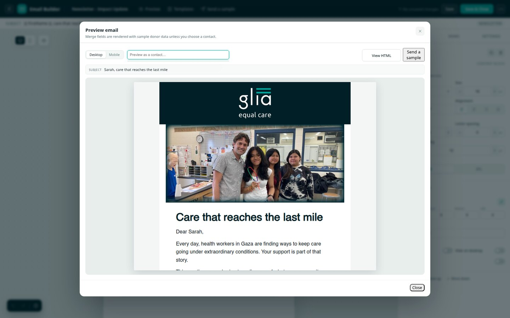
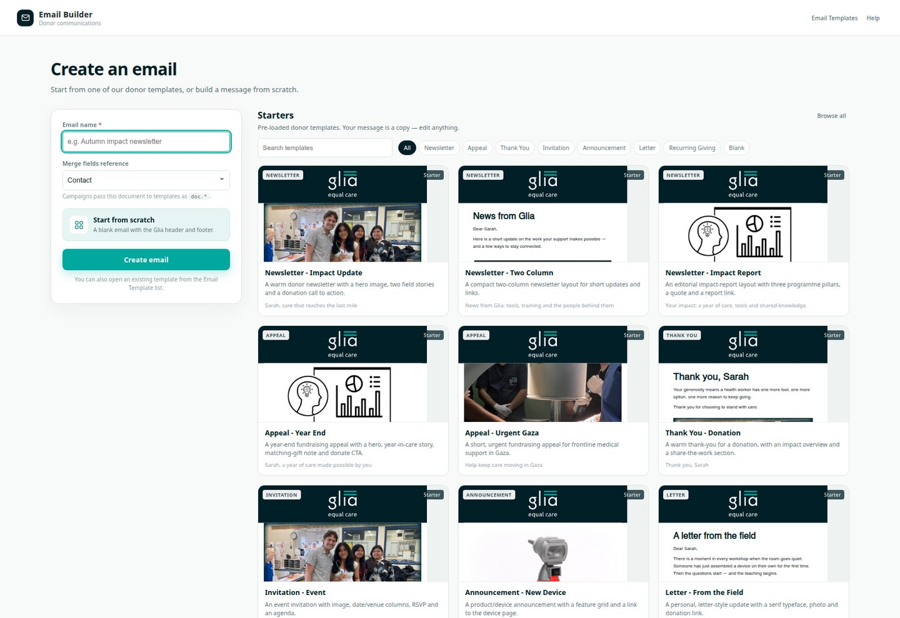

# Glia Email Builder

A block-based WYSIWYG email editor for ERPNext donor communications, modelled on
EveryAction's drag-and-drop **Targeted Email** builder.

It adds a full-screen design canvas and template library to ERPNext while keeping
the standard **Email Template** doctype as the thing that is actually sent. The
builder compiles each design into email-client-safe HTML and writes it to
`Email Template.response_html`, so existing **Email Campaign** sending, scheduling
and merge-field rendering continue to work without any custom send code.



## Highlights

- **EveryAction-style editor**: content palette, drag-and-drop rows and blocks,
  1–6 column layouts, inline rich-text editing, a floating formatting toolbar,
  content properties, block options and email-wide settings.
- **11 pre-loaded donor templates** (newsletter, appeal, thank-you, event,
  announcement, letter, recurring giving, blank) that staff can use as a copy and
  edit visually.
- **Build from scratch** with a blank Glia header/footer scaffold, or switch
  templates from the in-editor library.
- **Merge fields** with optional fallbacks, EveryAction-compatible aliases
  (`{{ FirstName }}`), and global organisation/link tokens.
- **Conditional content** using EveryAction macros (`equals`, `if`/`elseif`/
  `else`/`end`) translated into portable Jinja.
- **Row display conditions** so a row is only shown to matching recipients.
- **Desktop and mobile views**, hide-on-device, reverse stacking, and do-not-stack.
- **Image library** with public uploads, brand assets, search and URL entry.
- **Preview and send sample** rendered with sample donor data or a real Contact.
- **Autosave every 15 seconds**, undo/redo, and an EveryAction-style edit timeline.
- **Conflict detection** if another user or window saved the same template.
- **Email-safe output**: table layout, inline CSS, VML buttons for Outlook,
  responsive stacking, preheader text, and Frappe's unsubscribe placeholder.
- **Role-based access**: a dedicated `Email Builder User` role can edit builder
  templates without being a System Manager.
- **Remains editable as HTML**: the classic Email Template form and raw
  `response_html` are still available for advanced templates.



## Why a companion app?

ERPNext's core `Email Template` stores a subject and a text/HTML body. Replacing
its form in core would fork ERPNext and complicate upgrades. This app instead:

1. stores the editable block document in **Email Builder Design**;
2. compiles it to HTML + Jinja with the same renderer the preview uses;
3. writes the compiled result into the core **Email Template**, which continues
   to be the source of truth for sending.

The core `Email Campaign` job renders `{{ doc.* }}` against the recipient document
and sends the compiled HTML unchanged. No hooks or forks of the sending path are
required.

## Requirements

- Frappe/ERPNext **v16** (`frappe>=16`, `erpnext>=16`)
- Python 3.10+
- Node/npm only for the optional dev harness; the app itself has no build step
  and no external JS dependencies (SortableJS is vendored).

## Installation

### Bench

```bash
cd frappe-bench
bench get-app https://github.com/GliaX/glia-email-builder --branch v1.0.1

bench --site your.site install-app glia_email_builder
bench --site your.site migrate
bench build
bench restart
```

`install-app` creates the `Email Builder User` role, seeds the starter templates,
and creates the Email Builder settings singleton.

### Glia's Helm deployment

Glia's Kubernetes image in
[`GliaX/helm-erpnext`](https://github.com/GliaX/helm-erpnext) fetches this app at
the tag pinned in its Dockerfile. The site's `apps.txt` lives on a persistent
volume, so follow that repository's deployment notes for the one-time
`install-app`/`migrate` commands.

## Using the builder

1. Open **Email Template** from the Desk and click **New Email (Block Builder)**
   (or use the Email Builder entry on the apps screen).
2. Give the email a name, choose the merge-field reference doctype, and pick a
   starter or **Start from scratch**.
3. Use the three right-hand tabs:
   - **Content** – drag blocks onto the email, or click to add; select a block to
     edit its properties.
   - **Rows** – add layouts with one to six columns.
   - **Settings** – subject, preview text, category, brand colours, width, fonts,
     link/button colours and message size.
4. Click text on the canvas to edit it. Select text for the floating toolbar:
   bold/italic/underline, colour, links, lists, alignment, merge fields and
   conditional content.
5. Use **Preview** to see the rendered email and **Send a sample** to test in a
   real inbox.
6. **Save & Close** stores the compiled HTML on the Email Template. The template
   can then be selected in an Email Campaign exactly like before.



## Blocks

| Block | What it does | Notable properties |
|---|---|---|
| **Title** | H1/H2/H3 headings | level, font, size, colour, alignment |
| **Paragraph** | Rich-text block with paragraph spacing | typography, paragraph spacing, direction |
| **Text** | Inline rich text without paragraph margins | typography |
| **List** | Bulleted, numbered, letters or Roman | list style, start number |
| **Image** | Library or URL image, optional link | alt, link, width, alignment, radius |
| **Button** | Bulletproof donation/CTA button | link, colours, radius, full width |
| **Divider** | Styled horizontal rule | colour, thickness, width |
| **Spacer** | Vertical space | height |
| **Social** | Facebook, Instagram, X, LinkedIn, YouTube | URLs, icon size, spacing, alignment |
| **Video** | YouTube/Vimeo thumbnail link | URL, thumbnail, width |
| **HTML** | Raw email-safe HTML | inline source editor |

Rows support background colour/image, padding, column spacing, vertical alignment,
border radius, locking, hide-on-device, reverse stacking, do-not-stack and display
conditions.

## Merge fields

The picker inserts either a document field or a global token:

- `{{ doc.first_name }}` — resolved by ERPNext at send time from the recipient
  document (`Contact`, `Lead`, custom Donor doctype, …).
- `{{ doc.first_name|default('Friend', true) }}` — friendly fallback when empty.
- `{{ FirstName }}`, `{{ StateOrProvince }}`, `{{ LastGiftAmount }}` — EveryAction
  aliases; the compiler maps these to the configured expressions.
- `{{ OrganizationName }}`, `{{ OrganizationAddress }}`, `{{ Disclaimer }}`,
  `{{ DonateURL }}`, `{{ WebsiteURL }}`, `{{ UnsubscribeLink }}`,
  `{{ UnsubscribeURL }}` — resolved from **Email Builder Settings** at compile
  time.
- `{{ UnsubscribeURL }}` compiles to the `<!--unsubscribe_url-->` placeholder that
  Frappe's email queue replaces with a per-recipient signed unsubscribe URL.

Merge fields are managed in **Email Builder Settings → Merge Fields**. All fields
from the design's `Reference DocType` are also offered automatically. The
reference is stored on the design because not every ERPNext 16 build exposes a
reference field on the core Email Template doctype.

### Conditional content

EveryAction syntax is supported in any text block and in the subject:

```text
{{ if equals(doc.state, 'CA') }}
California content
{{ elseif equals(doc.state, 'NY') }}
New York content
{{ else }}
Everyone else
{{ end }}
```

Supported macros: `equals`, `not_equals`, `less_than`, `greater_than`,
`less_than_or_equal_to`, `greater_than_or_equal_to`, `contains`, `not_contains`,
plus `{{each FieldArray}}…{{loop_var}}…{{end}}`.

### Row conditions

Select a row, open **Rows → Display condition**, choose a merge field, operator and
value. The row's compiled HTML is wrapped in `` and is skipped for
non-matching recipients. A custom Jinja expression is also accepted.

## Pre-loaded templates

| Template | Category | Purpose |
|---|---|---|
| Newsletter – Impact Update | Newsletter | Hero image, two field stories, impact pillars, donate CTA |
| Newsletter – Two Column | Newsletter | Compact two-column update |
| Newsletter – Impact Report | Newsletter | Year-in-review editorial layout |
| Appeal – Year End | Appeal | Year-end appeal with matching-gift note |
| Appeal – Urgent Gaza | Appeal | Short, urgent frontline care appeal |
| Thank You – Donation | Thank You | Warm thank-you with impact overview |
| Invitation – Event | Invitation | Event invite with date/venue and RSVP |
| Announcement – New Device | Announcement | Device announcement with feature grid |
| Letter – From the Field | Letter | Serif letter-style update |
| Recurring Giving – Monthly Donor | Recurring Giving | Monthly ask with conditional thank-you |
| Blank – Logo & Footer | Blank | Clean Glia header/footer starting point |

Seeded templates are ordinary Email Templates: use them directly, edit them, or
duplicate them. The copy and sample links are starting points; replace them with
current campaign details.



## Settings

**Email Builder Settings** (System Manager) holds:

- organisation name/address/disclaimer and optional logo;
- brand colours and default fonts;
- donation, website and social URLs;
- unsubscribe link text;
- default reference doctype;
- the merge-field table and sample preview values;
- an option to prompt for the builder on new Email Templates.

After changing global branding, click **Recompile Block Templates** on the settings
form to refresh every stored Email Template.

## Permissions

- **System Manager** – full access.
- **Email Builder User** – create/edit Email Builder designs; a Custom DocPerm
  grants read/write/create on Email Templates (no delete). Assign this role to
  communications staff instead of making them System Managers.
- The page itself is restricted to those two roles.
- Preview and sample sends use the same permission checks; sample sends are
  limited to 10 addresses per request.

## Deployment notes

- **Image size / Gmail clipping**: the builder warns above ~102 KB and hard-fails
  at 150,000 bytes (EveryAction's limit). Gmail clips around 102 KB.
- **Images must be public** (`is_private = 0`) so email recipients can load them.
  The image manager uploads to the public Files area and offers the bundled Glia
  brand assets.
- **Email HTML**: table-based with inline styles, Outlook VML buttons,
  `mso-hide`/mobile media queries and a hidden preheader. Media-query behaviour
  (stacking, hide-on-mobile) is supported by Apple Mail, Gmail and most modern
  clients; Outlook desktop ignores media queries and shows the desktop layout.
  Background images are also client-dependent.
- **Frappe's email wrapper**: ERPNext's Email Campaign passes the template body
  through `frappe.sendmail(content=...)`, which wraps it in
  `templates/emails/standard.html`. The builder therefore stores the body plus
  its `<style>` blocks in `Email Template.response_html` (not a complete
  `<html>` document, which would produce nested documents). The builder's
  `.geb-*` responsive rules are also registered through the `email_css` hook so
  their `@media` queries end up in the wrapper's `<head>`, where Gmail honours
  them. The full document is kept on `Email Builder Design.compiled_html` and
  used by the builder preview.
- **Plain text**: Frappe derives the plain-text alternative from the HTML. The
  builder stores a readable plain-text preview on the design for reference.
- **Unsubscribe**: the footer uses Frappe's `<!--unsubscribe_url-->` placeholder.
  Frappe needs a reference document to build a signed unsubscribe URL, and the
  core Email Campaign job does not pass one. A small `Email Queue.before_insert`
  hook (`integration.set_campaign_unsubscribe_reference`) copies the campaign
  reference from the linked Communication onto any queue entry that contains the
  placeholder, so campaign unsubscribe links work. For non-campaign
  `sendmail` calls without a reference, the link can be empty — configure the
  Email Account footer or use a campaign.
- **Email Group campaigns** pass the Email Group document, not a Contact, as
  `doc`; per-recipient merge fields therefore need a Contact/Lead campaign or a
  custom sending path. The builder shows the reference doctype on the settings
  tab so this is explicit.
- **Recompiling after a settings change**: stored Email Templates keep their
  compiled HTML until re-saved or recompiled from the settings form.

## Development

### Standalone harness (no bench required)

```bash
python3 dev/build_harness_data.py
cd dev/harness
python3 -m http.server 8808
```

- Start screen: <http://127.0.0.1:8808/>
- Editor: <http://127.0.0.1:8808/?template=Newsletter%20-%20Impact%20Update>

The harness mocks Frappe calls and renders the real seed designs with the Python
renderer. It is useful for UI iteration and screenshots.

### Tests

```bash
python3 -m pytest tests/
```

The tests cover EveryAction macro translation, sanitisation (including Jinja
preservation), all block types, row conditions, subject translation, unsubscribe
placeholders, mobile classes and every seed template.

### Repository layout

```text
glia-email-builder/
├── glia_email_builder/
│   ├── builder/                 # pure-Python schema, macros, renderer, seeds
│   ├── email_builder/
│   │   ├── doctype/             # Design, Settings, Merge Field
│   │   └── page/email_builder/  # Desk page, entry JS + full stylesheet
│   ├── public/js/               # builder UI modules, form/list integrations
│   ├── public/css/              # responsive rules for Frappe's email wrapper
│   └── public/images/           # brand assets used by templates
├── dev/                         # standalone harness and seed-data generator
├── docs/screenshots/
├── tests/
├── LICENSE                      # AGPL-3.0-or-later
└── pyproject.toml
```

The renderer (`builder/render.py`) is intentionally pure Python so it can be
tested and previewed without a bench. Frappe-aware compilation lives in
`builder/compiler.py`.

## EveryAction parity

| EveryAction | This app |
|---|---|
| Drag & drop editor, content/rows/settings tabs | ✅ same three-tab model |
| Title, Paragraph, Text, List, Image, Button, Divider, Social, HTML, Video, Spacer | ✅ all eleven |
| 1–6 column rows, column spacing | ✅ |
| Move, duplicate, delete blocks and rows | ✅ plus move up/down and keyboard delete |
| Content properties + block options | ✅ |
| Width/alignment/background/fonts/link colours | ✅ |
| Desktop/mobile editor, hide on device, reverse/no stack | ✅ |
| Merge fields with alternate text | ✅ |
| Conditional content macros | ✅ translated to Jinja |
| Row display conditions | ✅ |
| Image File Manager (upload/search/insert, no delete) | ✅ (no in-browser image editor) |
| Merge field picker with grouped search | ✅ |
| Autosave 15s, undo/redo, timeline last 15 edits | ✅ |
| Preview and send sample | ✅ |
| Template library with starters | ✅ 11 donor templates |
| Custom templates, duplicate | ✅ |
| Reusables / themes | ➖ not part of EveryAction's drag-and-drop editor either |
| Smart Links / contribution amount wizard | ➖ not implemented; use `{{ DonateURL }}` and the donation page |
| A/B testing | ➖ use ERPNext campaign variants; no builder UI |
| HTML export | ✅ extra: View HTML / download |
| Classic code editor | ✅ the standard Email Template form remains |

## Known limitations

- In-browser image editing (crop/resize) is not included; images are displayed at
  the configured block width.
- Link click tracking is not implemented; add UTM parameters to URLs or use
  your ESP/analytics layer.
- The timeline is client-side (last 50 snapshots); Frappe's Version history on the
  design doctype provides a server-side audit trail of saves.
- Email-client support for media queries and background images varies; test a
  sample in the clients your donors actually use.
- The builder is a Desk page; it is not available on the website/portal.

## License

Copyright (C) 2026 Glia.

This program is free software: you can redistribute it and/or modify it under
the terms of the GNU Affero General Public License as published by the Free
Software Foundation, either version 3 of the License, or (at your option) any
later version.

This program is distributed in the hope that it will be useful, but **without
any warranty**; without even the implied warranty of merchantability or fitness
for a particular purpose. See the GNU Affero General Public License for more
details.

You should have received a copy of the GNU Affero General Public License along
with this program. If not, see <https://www.gnu.org/licenses/>. The full text is
in [LICENSE](LICENSE).

Bundled third-party asset: [SortableJS](https://github.com/SortableJS/Sortable)
1.15.6 (MIT) in `glia_email_builder/public/js/email_builder/vendor/`.

The Glia name, logo and starter-template photography are Glia trademarks and
brand assets; the AGPL license does not grant permission to use them. Replace
them if you reuse this app outside Glia.
